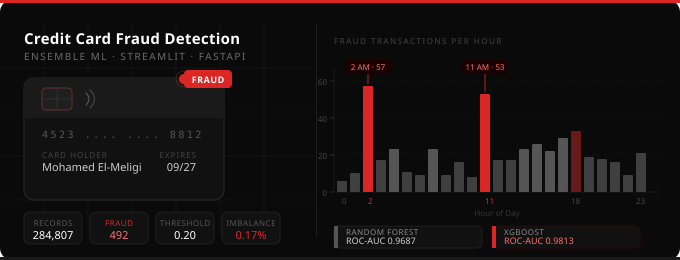
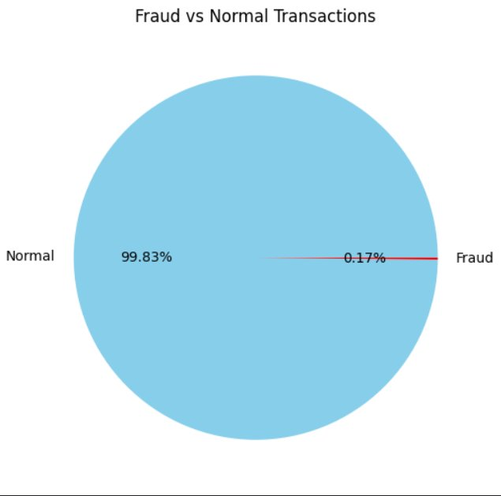
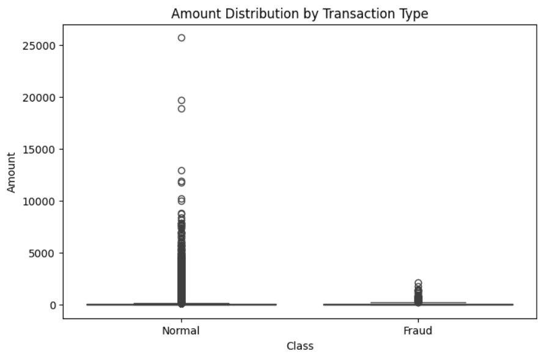
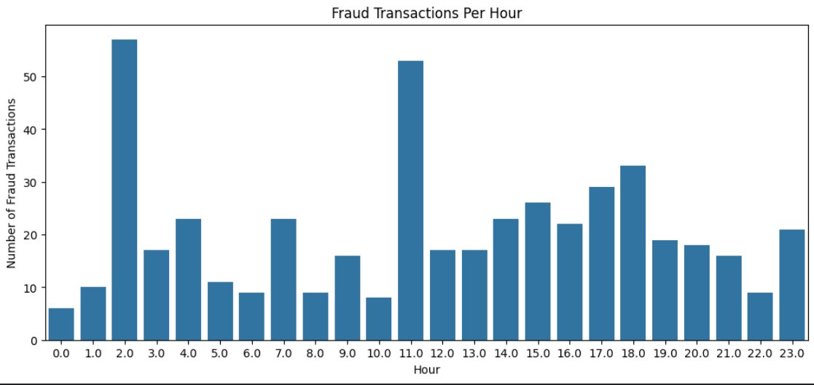
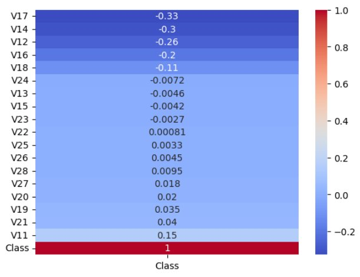
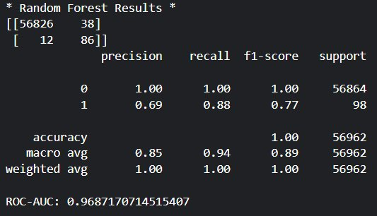
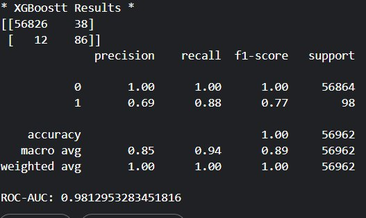

# Credit Card Fraud Detection

<p align="center">
  
</p>

<p align="center">
  
  
  
  
  
  
</p>

<p align="center">
  Real-time credit card fraud detection using a <strong>Random Forest + XGBoost</strong> ensemble,<br/>
  served through a Streamlit dashboard and a FastAPI backend.
</p>

---

## Project Structure

```
Fraud-Detection/
│
├── app/
│   └── app.py                              # Streamlit dashboard
│
├── data/
│   ├── raw/                                # Original dataset (creditcard.csv)
│   └── processed/                          # Cleaned & engineered data
│
├── models/
│   ├── random_forest.pkl                   # Trained Random Forest model
│   └── xgboost.pkl                         # Trained XGBoost model
│
├── notebooks/
│   └── credit-card-fraud-detection.ipynb   # EDA, training & evaluation
│
├── outputs/                                # EDA & results plots
│
├── main.py                                 # FastAPI backend
├── banner.svg
├── requirements.txt
├── .gitignore
├── LICENSE
└── README.md
```

---

## Quick Start

**1. Clone the repo**
```bash
git clone https://github.com/muhammed-alaa74/credit-card-fraud-detection.git
cd credit-card-fraud-detection
```

**2. Install dependencies**
```bash
pip install -r requirements.txt
```

**3. Download the dataset**

Get `creditcard.csv` from [Kaggle](https://www.kaggle.com/datasets/mlg-ulb/creditcardfraud) and place it in `data/raw/`.

**4. Run the Streamlit dashboard**
```bash
streamlit run app/app.py
```

**5. Run the FastAPI backend**
```bash
uvicorn main:app --reload
```

API docs available at `http://127.0.0.1:8000/docs`

---

## Exploratory Data Analysis

### Class Imbalance

Only **0.17%** of transactions are fraudulent.

<p align="center">
  
</p>

### Amount Distribution by Class

Fraud transactions tend to be lower in amount and far less spread than normal ones.

<p align="center">
  
</p>

### Fraud Transactions Per Hour

Fraud spikes at **2 AM** and **11 AM** — two high-risk windows.

<p align="center">
  
</p>

### Feature Correlation with Target

Features **V17, V14, V12, V16** show the strongest negative correlation with fraud.

<p align="center">
  
</p>

---

## Feature Engineering

| Feature | Description |
|---|---|
| `scaled_amount` | Z-score normalized amount |
| `scaled_time` | Z-score normalized time |
| `log_amount` | `log1p` transform — reduces skew |
| `Hour` | Hour of day extracted from `Time` |
| `is_night` | `1` if hour <= 6 |
| `high_amount` | `1` if amount > 95th percentile |
| `amount_per_hour` | Amount / (hour + 1) |

---

## Model Results

Both models use a fraud threshold of **0.20** to maximize recall.

### Random Forest

<p align="center">
  
</p>

| Metric | Normal | Fraud |
|---|---|---|
| Precision | 1.00 | 0.69 |
| Recall | 1.00 | **0.88** |
| F1-Score | 1.00 | 0.77 |
| ROC-AUC | — | **0.9687** |

### XGBoost

<p align="center">
  
</p>

| Metric | Normal | Fraud |
|---|---|---|
| Precision | 1.00 | 0.69 |
| Recall | 1.00 | **0.88** |
| F1-Score | 1.00 | 0.77 |
| ROC-AUC | — | **0.9813** |

### Model Comparison

| Model | Recall | F1 | ROC-AUC |
|---|---|---|---|
| Random Forest | 88% | 77% | 0.9687 |
| **XGBoost** | **88%** | **77%** | **0.9813** |

> XGBoost edges out Random Forest on ROC-AUC, making it the stronger model for ranking fraud risk.

---

## API Endpoints

Run the FastAPI backend with:

```bash
uvicorn main:app --reload
```

Interactive docs available at `http://127.0.0.1:8000/docs`

| Method | Endpoint | Description |
|---|---|---|
| GET | `/` | API info and version |
| GET | `/health` | Health check + loaded models + threshold |
| POST | `/predict` | RF + XGBoost ensemble — returns both results + verdict |
| POST | `/predict/random-forest` | Random Forest only |
| POST | `/predict/xgboost` | XGBoost only |

### Request

All `/predict` endpoints expect a JSON body with exactly **35 floats** (engineered features):

```json
{
  "features": [0.12, -1.35, 2.11, 0.87, ..., 0.04]
}
```

### Response — `/predict`

```json
{
  "random_forest": {
    "model": "Random Forest",
    "fraud_probability": 0.031200,
    "fraud_percentage": "3.12%",
    "prediction": "Legit",
    "confidence": "0.4688"
  },
  "xgboost": {
    "model": "XGBoost",
    "fraud_probability": 0.741000,
    "fraud_percentage": "74.10%",
    "prediction": "Fraud",
    "confidence": "0.2410"
  },
  "ensemble_verdict": "Fraud",
  "most_confident": "Random Forest",
  "latency_ms": 12.4
}
```

### Response — `/health`

```json
{
  "status": "healthy",
  "models_loaded": ["random_forest", "xgboost"],
  "fraud_threshold": 0.20,
  "expected_features": 35
}
```

---

## Requirements

```
fastapi==0.136.1
uvicorn==0.47.0
python-multipart==0.0.29
pandas==2.3.3
numpy==2.3.5
scipy==1.16.3
scikit-learn
xgboost==3.2.0
lightgbm
catboost>=1.2.0; python_version < "3.14"
imbalanced-learn
joblib
matplotlib==3.10.6
seaborn
plotly
streamlit
PyYAML
pillow
```

---

## Roadmap

- [ ] SHAP explainability per transaction
- [ ] Batch prediction via CSV upload
- [ ] ROC / PR curve metrics in dashboard
- [ ] Deploy to Streamlit Cloud

---

## License

[MIT](LICENSE)

